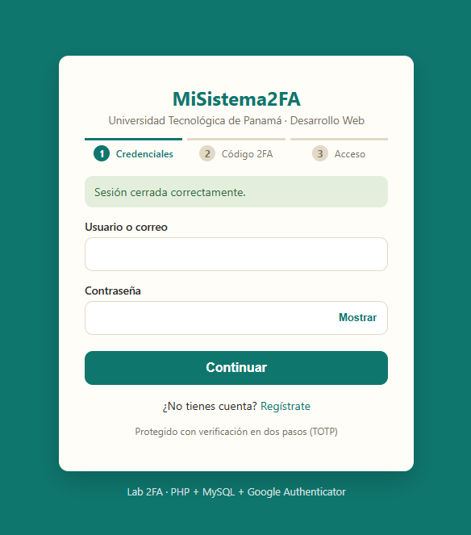
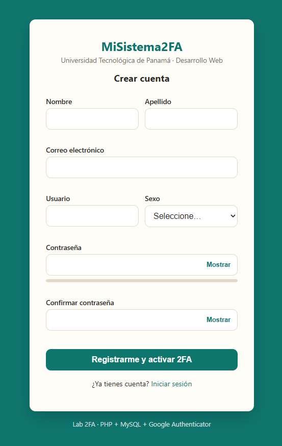
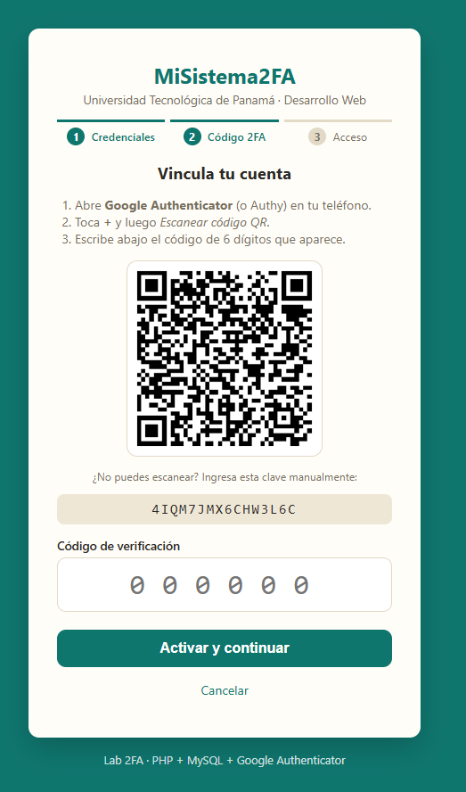
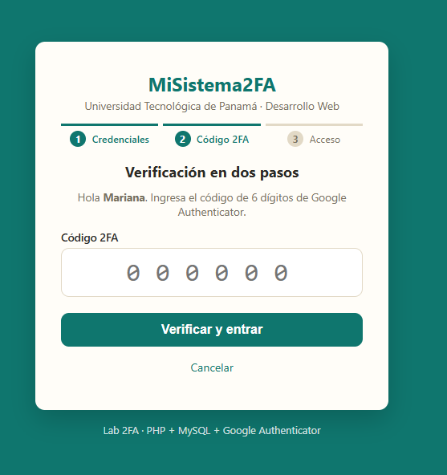
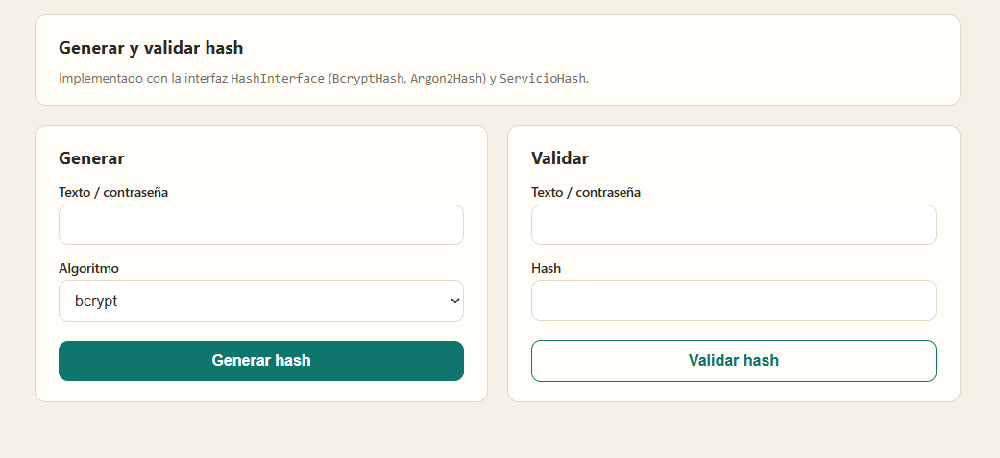
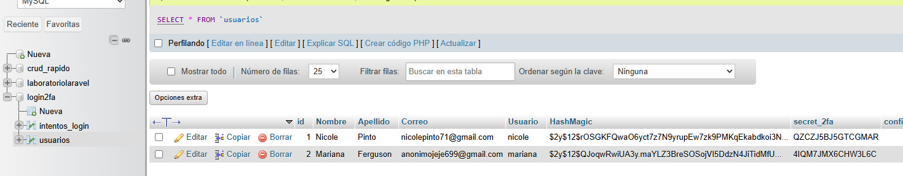

# Laboratorio 2FA - Parcial Práctico de Desarrollo Web

**Fecha:** 24/11/2026

## Contenido del Repositorio

Sistema de **registro e inicio de sesión con autenticación de dos factores (2FA)** desarrollado en PHP orientado a objetos. El usuario se registra, vincula su cuenta con **Google Authenticator** escaneando un código QR y, en cada inicio de sesión, debe ingresar su contraseña y luego el código de 6 dígitos (TOTP) antes de entrar al sistema.

La práctica abarca:

- Usuarios de MySQL con **privilegios mínimos** (la aplicación nunca usa `root`).
- Formulario de registro con validaciones en el cliente y en el servidor, y verificación de correo y usuario duplicados.
- **Sanitización** de datos mediante una clase con métodos estáticos.
- Generación del **código QR** y verificación del código TOTP.
- **Dos sesiones**: una previa (usuario y contraseña) y otra definitiva que se crea solo después de validar el código 2FA.
- Interfaz para **generar y validar hashes** (bcrypt y argon2id) aplicando POO.
- Protección **anti-CSRF** con tokens.
- Registro de intentos de acceso en base de datos.

## Tecnologías Utilizadas


- **Lenguaje / Framework:** PHP 8 (POO, PDO), JavaScript, HTML5 y CSS3. Sin framework.
- **Librería:** `sonata-project/google-authenticator` (incluida en `vendor/`).
- **Base de datos:** MySQL / MariaDB, administrada con phpMyAdmin.
- **Herramientas:** XAMPP (Apache + MySQL), Git y GitHub, aplicación Google Authenticator.

## Capturas de Pantalla y Problemas


### Interfaz Principal



### Problemas / Ejercicios

#### 1. Formulario de registro 
Formulario con campos requeridos, correo válido, contraseñas coincidentes e indicador de fuerza de la clave. La lógica está en la clase `RegistroUsuario`, donde cada método tiene una sola responsabilidad.



#### 2. Generación del código QR
Al registrarse, se genera un secreto en base32 que se guarda por usuario y se muestra como QR para escanearlo con Google Authenticator.



#### 3. Inicio de sesión y solicitud del código 2FA
Primero se validan usuario y contraseña; después se pide el código TOTP antes de permitir el acceso. Hay bloqueo temporal tras varios intentos fallidos.



#### 4. Interfaz para generar y validar hash (POO)
`HashInterface` define el contrato; `BcryptHash` y `Argon2Hash` lo implementan y `ServicioHash` los usa por polimorfismo.



#### 5. Tablas de la base de datos
`usuarios` e `intentos_login` registran los datos de la aplicación.



## Estructura de Carpetas o Directorios

```plaintext
Lab2FA_PHP/
├── clases/                 # Clases de la aplicación (POO)
│   ├── Conexion.php            # Conexión PDO con usuarios de privilegios mínimos
│   ├── SanitizarEntrada.php    # Métodos estáticos de sanitización
│   ├── RegistroUsuario.php     # Formulario de registro (validación y guardado)
│   ├── UsuarioRepository.php   # Único acceso a las tablas (consultas preparadas)
│   ├── ValidacionLogin.php     # Fase 1 del login y bloqueo por intentos
│   ├── Autenticador2FA.php     # Secreto, QR y verificación TOTP
│   ├── SesionSegura.php        # Sesiones PREAUTH_2FA y APP_SESION
│   ├── CSRFProtection.php      # Tokens anti-CSRF
│   ├── HashInterface.php       # Contrato de hash
│   ├── BcryptHash.php          # Implementación bcrypt
│   ├── Argon2Hash.php          # Implementación argon2id
│   └── ServicioHash.php        # Servicio que usa cualquier HashInterface
├── config/
│   └── config.php          # Configuración de BD, bloqueos y vigencias
├── includes/
│   ├── bootstrap.php       # Autocarga, cabeceras de seguridad, manejo de errores
│   └── plantilla.php       # Encabezado y pie comunes
├── sql/
│   ├── 01_base_datos_y_tablas.sql          # Base de datos y tablas
│   ├── 02_usuarios_privilegios_minimos.sql # Usuarios y privilegios
│   └── 03_ver_privilegios.sql              # Comandos SHOW GRANTS
├── css/estilo.css          # Estilos de la aplicación
├── js/registro.js          # Validaciones del lado del cliente
├── docs/capturas/          # Capturas de pantalla del README
├── vendor/                 # Librería google-authenticator
├── index.php               # Punto de entrada
├── registro.php            # Formulario de registro
├── login.php               # Inicio de sesión (paso 1)
├── qr_setup.php            # Código QR y primera confirmación
├── verificar_2fa.php       # Solicitud del código 2FA (paso 2)
├── panel.php               # Panel interno
├── hash_tool.php           # Generar y validar hash
├── privilegios.php         # Privilegios de los usuarios de BD
├── check_duplicado.php     # Endpoint AJAX de duplicados
├── salir.php               # Cierre de sesión
└── README.md               # Documentación del proyecto
```

## Instrucciones de Ejecución / Uso

### Requisitos
- XAMPP (o similar) con PHP 8.0 o superior y MySQL/MariaDB.
- Google Authenticator instalado en el teléfono, con la hora en modo automático.
- Conexión a Internet (el QR se genera con `api.qrserver.com`).

### Pasos

1. **Clonar el repositorio** dentro de la carpeta web:
   ```bash
   cd C:\xampp\htdocs
   git clone <URL-del-repositorio> lab2fa_php
   ```
2. **Iniciar Apache y MySQL** desde el panel de XAMPP.
3. **Crear la base de datos y las tablas.** En phpMyAdmin (usuario `root`), pestaña **SQL**, ejecutar `sql/01_base_datos_y_tablas.sql`.
4. **Crear los usuarios con privilegios mínimos.** Ejecutar `sql/02_usuarios_privilegios_minimos.sql` (después del 01).
5. **Revisar la configuración** en `config/config.php` (host, puerto y credenciales de `app_2fa` y `lector_2fa`).
6. **Abrir la aplicación** en `http://localhost/lab2fa_php/`.

### Uso

1. Ir a **Registro** y completar el formulario.
2. Escanear el QR con Google Authenticator e ingresar el código de 6 dígitos para activar el 2FA.
3. Iniciar sesión con usuario o correo y contraseña.
4. Ingresar el código 2FA vigente para acceder al panel.
5. Desde el menú se accede a **Hash** y **Privilegios BD**.

### Problemas frecuentes

| Mensaje | Solución |
|---|---|
| `Access denied for user 'app_2fa'` | Ejecutar el script 02 con `root` |
| `Unknown database 'login2fa'` o tabla inexistente | Ejecutar el script 01 con `root` |
| Código 2FA siempre incorrecto | Activar la hora automática en el teléfono |
| `Token CSRF inválido` | Recargar la página y enviar de nuevo |

> Antes de entregar, cambiar `'debug' => true` a `false` en `config/config.php`.

## Autor y Contexto

- **Nombre:** Nicole Pinto e Irving Cruz
- **Institución:** Universidad Tecnológica de Panamá (UTP), Facultad de Ingeniería en Sistemas
- **Asignatura:** Desarrollo Web
- **Fecha de Realización:** 25/11/2026


